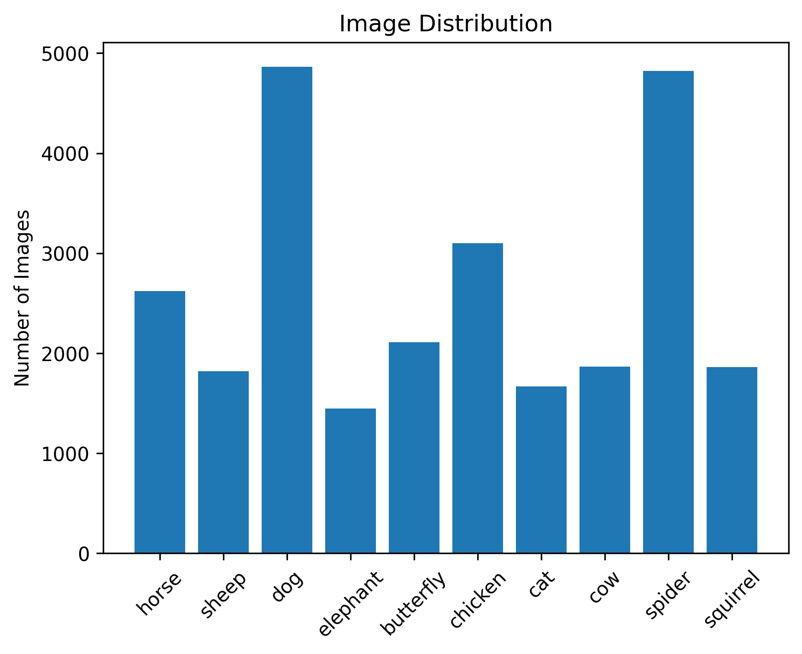

# Image-Identification-Using-Deep-Learning

## Project Topic

This is the dataset I am using for my deep learning project: 

https://www.kaggle.com/datasets/alessiocorrado99/animals10/data

I like this dataset because it has simple categories, and a large number of images (28,000). The categories are: dog, horse, elephant, butterfly, chicken, cat, cow, spider, sheep, and squirrel. This is a set of images that someone used for their matriculation thesis, and it has been downloaded from Kaggle over 100,000 times, so I believe it is a good test dataset to use. These are all images that have been collected from Google Images.

For this project, I will test a Convolutional Neural Network (CNN), and adjust the hyperparameters to see how it affects my model's performance. I wanted to keep this project simple, so my main goal is to get the best-working model I can. 

## Data cleaning and EDA, Data Preprocessing 

The first issue I noticed is that my folder names are all in Italian. So I needed to rename each folder with the corresponding English name. 

To check my class distribution, to see if my dataset is imbalanced. I can see that some groups, like dogs, have three times the amount of images as other groups, like elephants. But even in the elephant group, there are approximately 1500 images, so that should still be enough to make a working model. If I have issues later on with the groups with less images, I will come back to this. 

To check the dimensions of my images, to see how much they vary, because they were collected from google images. Because my dog folder has the most images, I took the dimensions of all the images in that folder. I can see that there is a wide variety of image sizes I will either need to crop or resize my images. I will try both options when I start working with my model. 

Project topic: (5 pts)
Is there a clear explanation about what this project is about? Does it state clearly which type of problem (task)?
Does it state the motivation or the goal (or why it’s important) clearly?
Data: (5 pts)
Is data source properly quoted and described? (including links, brief explanations)
Do they explain the data description properly?
Data cleaning and EDA, data preprocessing (10 pts)

Does it include clear explanations on how and why a cleaning is performed? Depending on your data, some examples of EDA might include:

Text data examples: Basic EDA such as word count, histogram etc and basic data cleaning such as stop words removal, Explaining word embedding methods: When you evaluate, the score is based on how they demonstrated understanding by explaining the concepts and giving reasonings why they chose the methods/techniques etc, but not based on just complexity of the model or technique or just performance alone.

Image or sound data examples: Pixel value count or histogram, spectral analysis such as power spectrum or frequency analysis to make feature vectors, etc

Does it include clear explanations on how and why an certain analysis (EDA) is performed?

Does it have proper visualization?

Does it have proper analysis? E.g. histogram, correlation matrix, heatmap, plots etc.

Does it have conclusions or discussions? E.g. the EDA summary, findings, discussing foreseen difficulties and/or analysis strategy.

Model building / Model choice (15 pts)
How many models have been used and compared? Any reasonings for model choice?

Model training (15 pts)
Show model training procedure including hyper parameter tuning. Show any procedure for measuring train and/or test performances. Visualization of tracking overfitting.

Results and Analysis: (15 pts)

Does it have a summary of results and analysis?
Does it have a proper visualization? (e.g. tables, graphs/plots, heat maps, statistics summary with interpretation etc)
Does it use different kinds of evaluation metric properly? Also does it explain why they chose the metric?
Does it iterate the training and evaluation process and improve the performance? Does it address selecting features through the iteration process?
Did the author compare the results from the multiple models and did appropriate comparison?
Discussion and Conclusion: (10 pts) Add your discussion on the results, ways to improve the results

Overall presentation/writeup: (5 pts) Is writeup/presentation organized and clear?
