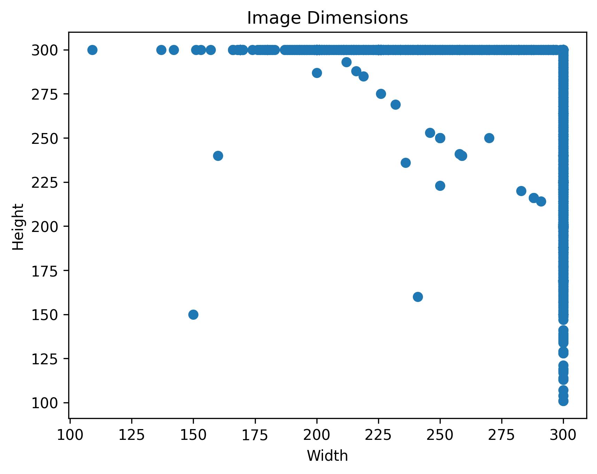
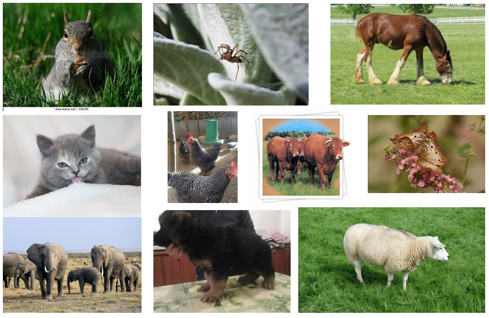

# Image-Identification-Using-Deep-Learning

## Project Topic

This is the dataset I am using for my deep learning project: 

https://www.kaggle.com/datasets/alessiocorrado99/animals10/data

I like this dataset because it has simple categories, and a large number of images (28,000). The categories are: dog, horse, elephant, butterfly, chicken, cat, cow, spider, sheep, and squirrel. This is a set of images that someone used for their matriculation thesis, and it has been downloaded from Kaggle over 100,000 times, so I believe it is a good test dataset to use. These are all images that have been collected from Google Images.

For this project, I will test a Convolutional Neural Network (CNN), and adjust the hyperparameters to see how it affects my model's performance. I wanted to keep this project simple, so my main goal is to get the best-working model I can. 

## Data cleaning and EDA, Data Preprocessing 

The first issue I noticed is that my folder names are all in Italian. So I needed to rename each folder with the corresponding English name. 

To check my class distribution, to see if my dataset is imbalanced. I can see that some groups, like dogs, have three times the amount of images as other groups, like elephants. But even in the elephant group, there are approximately 1500 images, so that should still be enough to make a working model. If I have issues later on with the groups with less images, I will come back to this. 

To check the dimensions of my images, to see how much they vary, because they were collected from google images. Because my dog folder has the most images, I took the dimensions of all the images in that folder. I can see that there is a wide variety of image sizes I will either need to crop or resize my images. I will try both options when I start working with my model. 

To get a quick overview of my images, I selected a random image from each folder. From this, I could see that there are a wide variety of images, some where the animal is in the center, some where the animal is more to the side. Some with a single animal, and some with multiple. Some have a watermark or frame, while others don't. My guess is that resizing my images will be better than cropping for this dataset, because there is so much variety, but I will try both and see. 

Next, I checked to see if there were any corrupt images using .verify() and did not see any corrupt images. This function will not detect all corrupt images as it doesn't actually open every image, but this is a quick way to initially check for corrupt images. 

Next, I collected all of the color formats that the images have, and counted how many images are of each type. It told me that I have 26,128 RGB images, 49 RGBA images, 1 CMYK image, and 1 L image. Because so many images are RGB, I decided to delete the images that are not RGB. 

All images were resized to 128 x 128 by stretching or squashing the images, not by cropping. The original files have not been edited so I can go back and change this later if needed

The images were divided into test and training sets, with 20% of the images used for training, and 80% of the images used for testing. I stratified the data so there was an even amount of images in the test and training sets for each image category. 

## Model building / Model choice 

For this project, I wanted to start with a simple CNN.

https://www.geeksforgeeks.org/machine-learning/image-classifier-using-cnn/

How many models have been used and compared? Any reasonings for model choice?

Model training (15 pts)
Show model training procedure including hyper parameter tuning. Show any procedure for measuring train and/or test performances. Visualization of tracking overfitting.

Results and Analysis: (15 pts)

Does it have a summary of results and analysis?
Does it have a proper visualization? (e.g. tables, graphs/plots, heat maps, statistics summary with interpretation etc)
Does it use different kinds of evaluation metric properly? Also does it explain why they chose the metric?
Does it iterate the training and evaluation process and improve the performance? Does it address selecting features through the iteration process?
Did the author compare the results from the multiple models and did appropriate comparison?
Discussion and Conclusion: (10 pts) Add your discussion on the results, ways to improve the results

Overall presentation/writeup: (5 pts) Is writeup/presentation organized and clear?
